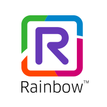

 
# Rainbow CSharp SDK examples - v3.x - Rainbow.Example.CommonWebRTC

This project is used as common library to all examples for SDK V3.X using WebRTC

It permits to centralize:
- same project / packages:
    - project reference to **Rainbow.Example.CommonSD2** (which also centralizes dependencies and objects)
    - package reference to **Rainbow.CSharp.SDK.WebRTC** and **Rainbow.CSharp.SDK.WebRTC.Desktop**
- same objects:
	- MediaTrackManager: use StreamInputManager to manage IAudioStreamTrack and IVideStreamTrack in a central point
